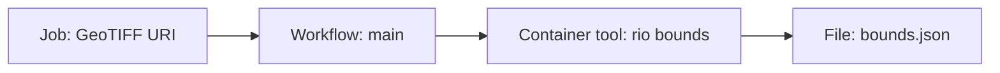

# EO Application Packages in 20 minutes

An **Earth Observation Application Package (EOAP)** describes how to run an EO application: its inputs, outputs, container software and workflow. A compatible runner can use that description to execute the application locally or on a processing platform, close to the data.

This module introduces the idea through one small example: give a GeoTIFF URL to `rio bounds` and receive a GeoJSON file describing its bounding geometry. You only need to recognise a command line and a URL. No cloud account or software installation is needed for the core lesson.

## Your 20-minute route

| Time | Activity | What you should be able to explain |
| --- | --- | --- |
| 0–3 min | Read this page | Why packaging helps others run your application |
| 3–7 min | [Meet the building blocks](cwl/nutshell.md) | How a container, tool and workflow fit together |
| 7–15 min | [Trace the example](quick-start.md) | How a job input becomes a command and an output |
| 15–18 min | [Build, deploy and run](usage-scenarios.md) | What the developer and platform each provide |
| 18–20 min | [Check your understanding](quick-start.md#check-your-understanding) | Identify the package's interface and portability limits |

## Why learn EOAP in 2026?

ESA's **EO Exploitation Platform Common Architecture (EOEPCA)** initiative makes application packaging part of a reusable platform architecture. Its evolution, **EOEPCA+**, develops interoperable building blocks for EO cloud platforms and federation. For students, EOAP is a practical way to describe an application so that those platforms can deploy and execute it. [ESA Common Architecture initiative](https://eo4society.esa.int/common-architecture/).

- **Deploy and execute:** EOEPCA's Processing building block supports OGC Application Packages expressed in CWL and describes execution through a CWL runner on Kubernetes. The package connects the developer's application to the platform's processing services. [EOEPCA processing architecture](https://eoepca.readthedocs.io/projects/architecture/en/latest/reference-architecture/processing-BB/).
- **Develop and share:** EOEPCA provides application packaging tools to build container images and describe command-line tools and workflows in CWL. Learning the package's interface prepares you to use these tools and publish your own EO applications. [Application package development tools](https://eoepca.readthedocs.io/technical/application-package-development-tools/).

These examples show broader use; support still varies between platforms. The [OGC Best Practice](https://docs.ogc.org/bp/20-089r1.html) supplies the common packaging guidance. This lesson uses CWL v1.2 and a typed URI record as a teaching convention.

## The problem EOAP solves

A script alone leaves questions unanswered: which libraries does it need, how do you pass data, and where are the results? An application package makes those choices explicit. The container supplies the software; CWL describes its invocation and the public interface; a job file supplies values for one run.

For this example:

After the lesson, use the optional notebooks to practise writing a CLI, building a container and running a package. The [history](background/background.md) explains how this approach developed.

*Adoption references reviewed on 11 October 2026.*
